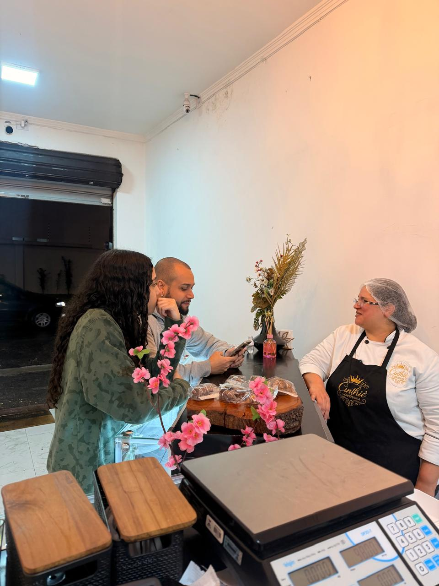
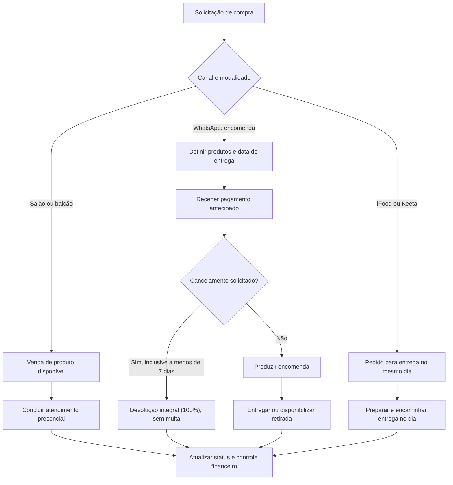

# Cinthiê Confeitaria — Entrega 2

Modelo lógico, implementação SQL e apresentação final — Modelagem de Banco de Dados.

**Relatório técnico — 13/11/2026.** Modelagem e implementação do banco de dados da Cinthiê Confeitaria.

## 1. Relatório Técnico Final

### Integrantes

| Nome completo | RGM | Usuário do GitHub |
|---|---|---|
| Douglas Lourenço de Lima | 47892919 | [Douglastail](https://github.com/Douglastail) |
| Erick Costa Liberato | 48201693 | ErickCLiberato |
| João Lucas Moreira dos Reis | 48162086 | [JoaoReeis](https://github.com/JoaoReeis) |
| Nicolas Nogueira Borges | 48329266 | [nogueiranicolas95-bot](https://github.com/nogueiranicolas95-bot) |

### 1.1 Revisão do Modelo Conceitual

#### Nome e natureza da organização

A organização analisada é a **Cinthiê Confeitaria**, empresa do ramo alimentício que fabrica e comercializa produtos de confeitaria no próprio estabelecimento.

#### Contexto e porte

Segundo a entrevista realizada com a responsável pelo estabelecimento, a confeitaria possui três funcionários. As atividades são distribuídas da seguinte forma:

- uma funcionária exerce as funções de **gerente e confeiteira**;
- um funcionário exerce as funções de **ajudante de cozinha e responsável pelo atendimento no balcão**;
- um funcionário exerce a função de **motoboy/entregador**.

A confeitaria atende clientes **no próprio salão, com mesas para consumo no local**, além de realizar vendas no **balcão**, receber **encomendas pelo WhatsApp** e receber **pedidos de entrega no mesmo dia pelos aplicativos iFood e Keeta**. WhatsApp e balcão são canais diretos; iFood e Keeta são plataformas de venda. **Os aplicativos não são utilizados para encomendas agendadas.**

Há **produtos prontos para venda no balcão e consumo nas mesas**, além de encomendas contratadas pelo WhatsApp e pedidos de entrega no dia pelos aplicativos. A produção relatada inclui atividades aos **domingos e às quartas-feiras**, sem pressupor que toda a produção se limite a esses dias. A **compra de insumos é realizada uma vez por mês**. O modelo registra compras mensais e itens adquiridos, mas não implementa controle de estoque de ingredientes ou produtos prontos; essa é uma delimitação do sistema proposto, e não a afirmação de inexistência de mercadorias disponíveis no estabelecimento.

#### Problemas e necessidades identificados

Atualmente, as informações da organização estão distribuídas entre WhatsApp, planilhas do Microsoft Excel e plataformas de venda. Parte do controle administrativo é realizada ao final do expediente, o que torna a organização e a consolidação das informações mais demoradas.

O sistema proposto busca centralizar os dados de clientes, pedidos, produtos, pagamentos diretos, eventuais estornos, plataformas, funcionários, insumos e compras, reduzindo o tempo gasto na consolidação de informações.

#### Empresa e projeto

**Como funciona atualmente — Cinthiê Confeitaria.** O controle administrativo é feito em planilhas Excel. Os pedidos chegam pelo WhatsApp, balcão, iFood e Keeta, deixando informações distribuídas entre canais. A conferência e a organização administrativa são realizadas ao final do expediente e incluem pagamentos e repasses das plataformas.

**O que propomos — projeto do grupo.** Um banco de dados para centralizar os registros de clientes, pedidos, produtos, pagamentos diretos, plataformas e funcionários envolvidos. As consultas SQL permitem buscar e relacionar essas informações. A estrutura também inclui compras, insumos e estornos diretos, conforme o modelo já documentado.

| Situação identificada pelo grupo | Melhoria proposta no banco |
|---|---|
| Informações de clientes em controles diferentes | Cadastro em `cliente`, relacionado aos pedidos quando houver cliente identificado. |
| Pedidos recebidos por vários canais | `pedido` com identificação do canal e da plataforma, quando aplicável. |
| Necessidade de relacionar produtos aos pedidos | `item_pedido` com produto, quantidade e preço praticado na venda. |
| Conferência de pagamentos diretos | `pagamento` com valor, data e forma de pagamento; `estorno` quando houver devolução. |
| Vendas pelo iFood e Keeta | `plataforma` vinculada ao pedido; pagamentos e estornos continuam nos aplicativos. |
| Participação dos funcionários nos pedidos | `pedido_funcionario` com o papel de cada participante. |
| Consulta em diferentes controles | Consultas SQL sobre os registros centralizados. |

**Nomes no conceitual e no SQL:** o relacionamento CONTÉM é representado pela tabela lógica `item_pedido`; a participação de funcionários é representada por `pedido_funcionario`. Portanto, `CONTEM` e `PARTICIPA_PEDIDO` não são nomes de tabelas do script atual.

**Exemplo de registro de encomenda.** Um cliente encomenda um bolo pelo WhatsApp. No funcionamento atual, as informações podem ser acompanhadas em controles diferentes. Na proposta do grupo, o registro relaciona:

1. O cliente em `cliente`.
2. A encomenda, sua data prevista e situação em `pedido`.
3. O bolo e sua quantidade em `item_pedido`, vinculado a `produto`.
4. O preço unitário praticado na encomenda, preservado em `item_pedido`.
5. O pagamento antecipado, seu valor e forma de recebimento em `pagamento`.
6. O funcionário envolvido e seu papel em `pedido_funcionario`.

Assim, as informações registradas podem ser consultadas em conjunto por SQL. Esses registros precisam ser inseridos no banco; não há integração automática com o WhatsApp.

**O que o projeto ainda não faz.** A entrega atual é uma estrutura de banco de dados com script e consultas, sem telas para os funcionários utilizarem. Ela não importa pedidos automaticamente do WhatsApp, iFood ou Keeta, não controla estoque em tempo real, não substitui automaticamente as planilhas e não realiza pagamentos nem entregas. A conferência de repasses existe na rotina administrativa descrita pelo grupo, mas o banco atual não registra repasses ou taxas dos aplicativos.

Telas e integrações podem ser desenvolvidas usando o banco como base.

#### Justificativa da escolha

A Cinthiê Confeitaria foi escolhida por ser uma organização real de pequeno porte e por permitir ao grupo a realização de pesquisa de campo. O estabelecimento possui uma rotina que envolve atendimento ao cliente, recebimento de pedidos por diferentes canais, fabricação sob demanda, pagamentos, entregas e controle administrativo, o que possibilita identificar entidades, atributos e relacionamentos relevantes para a elaboração de um modelo conceitual de dados.

Além disso, a utilização de WhatsApp, planilhas e plataformas de venda demonstra a existência de diferentes fontes de informação que podem ser organizadas de forma centralizada por meio de um banco de dados.

#### Evidências da organização

Como evidências da pesquisa de campo, foram realizadas fotografias do estabelecimento e uma gravação de áudio da entrevista com a responsável pela confeitaria. Esses materiais foram utilizados para apoiar o levantamento das informações, respeitando a autorização e a privacidade das pessoas envolvidas.

**Endereço do estabelecimento:** R. Césario Galero, 262, Tatuapé — São Paulo — SP, CEP 03071-000.

#### Problemas de gestão e escopo

Os códigos abaixo organizam as necessidades já descritas no levantamento; não acrescentam novos fatos sobre a organização.

| Código | Problema ou necessidade identificada | Resposta do modelo |
|---|---|---|
| P1 | Informações de pedidos e vendas dispersas entre WhatsApp, Excel e plataformas, dificultando a consolidação ao final do expediente. | Centralizar pedidos, itens, produtos, canais, plataformas e datas. |
| P2 | Necessidade de centralizar a conferência de pagamentos diretos e eventuais devoluções. | Relacionar pedido, pagamento e estorno, mantendo o histórico. |
| P3 | Necessidade de reunir os registros de compras e insumos mencionados na proposta. | Registrar compra, insumo, quantidade e custo unitário. |

**Escopo do banco:** clientes, pedidos, produtos, funcionários participantes, pagamentos diretos, estornos, compras e insumos. O modelo não inclui estoque, fornecedores, endereços de entrega, repasses, documentos fiscais ou escalas.

#### Entrevista e levantamento

O levantamento foi realizado por meio de entrevista presencial com a responsável pela confeitaria, com registro em áudio e [foto no estabelecimento](assets/imagem.jpeg). A organização possui três funcionários e realiza compras mensais de insumos. O [relato do levantamento](levantamento/levantamento.md) descreve os canais de venda, a produção, os pagamentos e o controle administrativo.

#### Processos de negócio

Os processos abaixo descrevem o atendimento, as encomendas, a produção, os pagamentos, as compras e o controle administrativo.

##### 1.1.1 Atendimento e identificação de clientes

- **Entrada:** solicitação presencial, mensagem de WhatsApp ou pedido recebido pela plataforma.
- **Atividades:** entender a solicitação; identificar o cliente quando necessário e quando os dados estiverem disponíveis; esclarecer produto, quantidade e condições do atendimento.
- **Saída:** informações que permitem registrar o pedido. No balcão, pode haver pedido sem cliente cadastrado, como admite a cardinalidade do DER.

##### 1.1.2 Recebimento de pedidos multicanal e consumo no local

- **Entrada:** compra para consumo no local, solicitação no balcão, encomenda pelo WhatsApp ou pedido de entrega no dia via iFood ou Keeta.
- **Atividades:** identificar a origem; diferenciar venda presencial, encomenda e pedido imediato do aplicativo; se for plataforma, registrar qual delas; selecionar produtos; informar quantidades e preços praticados; registrar o status inicial.
- **Limite do DER:** a distinção entre balcão e consumo nas mesas é operacional; o modelo atual não possui atributo específico para número de mesa ou atendimento no salão.
- **Saída:** pedido registrado e associado a pelo menos um produto.

##### 1.1.3 Cardápio e preços

- **Entrada:** catálogo de produtos e preços definidos pela confeitaria.
- **Atividades propostas para o sistema:** cadastrar e consultar produtos e seus preços atuais; ao vender, preservar o preço unitário praticado no vínculo entre produto e pedido.
- **Saída:** pedido com valores históricos coerentes, mesmo se o preço cadastrado do produto mudar.

##### 1.1.4 Encomendas pelo WhatsApp e agendamento

- **Entrada:** solicitação de encomenda pelo WhatsApp; os aplicativos não recebem encomendas agendadas.
- **Atividades:** confirmar itens e quantidades; negociar a data e a modalidade de recebimento; verificar disponibilidade de produção; informar o valor total e as condições de pagamento. **As encomendas feitas pelo WhatsApp exigem pagamento antecipado**, conforme informação complementar da responsável.
- **Saída:** encomenda aceita e acompanhada pelo pedido.
- **Confirmado:** pagamento antecipado nas encomendas por WhatsApp; cancelamentos de encomendas pelo WhatsApp, inclusive com menos de sete dias de antecedência da entrega, não geram multa nem retenção, com **devolução integral (100%) do valor pago**.

##### 1.1.5 Produção sob demanda

- **Entrada:** pedidos e encomendas aceitos.
- **Atividades:** planejar o preparo em função da demanda, produzir os itens e atualizar o andamento do pedido. O levantamento relata produção aos domingos e quartas-feiras.
- **Saída:** pedido preparado para entrega ou retirada.
- **Limite de escopo:** não há módulo de estoque ou ficha técnica de ingredientes na modelagem atual.

##### 1.1.6 Entrega dos pedidos no dia e de encomendas

- **Entrada:** pedido pronto para envio.
- **Atividades:** organizar o encaminhamento e a participação do funcionário que executa a entrega; acompanhar o estado do pedido.
- **Saída:** pedido entregue e concluído.

##### 1.1.7 Retirada no balcão e consumo no estabelecimento

- **Entrada:** produto selecionado para consumo no local ou pedido pronto para retirada.
- **Atividades:** disponibilizar o produto, atender clientes nas mesas quando aplicável, conferir dados do pedido quando necessários e concluir o atendimento.
- **Saída:** pedido retirado e situação atualizada.

##### 1.1.8 Pagamento dos pedidos diretos

- **Canais:** WhatsApp e balcão, com dinheiro, Pix ou cartão (incluindo maquininha).
- **Regra confirmada:** não há taxa ou multa de cancelamento para pagamentos nos canais diretos. Maquininha é meio de processamento de cartão, não um aplicativo de venda.
- **Encomendas por WhatsApp:** exigem pagamento antecipado; em caso de cancelamento, a devolução é integral (100% do valor pago), inclusive com menos de sete dias de antecedência.
- **Modelagem:** PEDIDO pode possuir zero ou vários PAGAMENTOS (ex.: recebimentos em etapas, se ocorrerem); um PAGAMENTO pertence a um único PEDIDO. ESTORNO representa uma devolução vinculada a um PAGAMENTO direto, quando realizada; no máximo um estorno por pagamento nesta versão.
- **Limite:** não se presume parcelamento/sinal e saldo como prática confirmada; a cardinalidade permite expansão futura, sem obrigar seu uso.

##### 1.1.9 Pedidos de aplicativo e repasses

- iFood e Keeta recebem pedidos para entrega no mesmo dia, sem encomendas agendadas.
- O PEDIDO registra o canal e qual PLATAFORMA o originou; **o pagamento, eventual cancelamento, estorno e possíveis taxas são processados pelo próprio aplicativo**, conforme suas políticas.
- O sistema da confeitaria **não cria PAGAMENTO nem ESTORNO internos para esses pedidos de aplicativo**. A conferência de repasses é descrita como processo administrativo, ainda sem entidade REPASSE.

##### 1.1.10 Cancelamento e reembolso por canal

- **WhatsApp, balcão e pagamentos na maquininha:** não existe taxa ou multa de cancelamento cobrada pela confeitaria.
- **Encomendas por WhatsApp:** quando há cancelamento de encomenda já paga, devolve-se **100% do valor pago**, independentemente de faltarem mais ou menos de sete dias para a data prevista.
- **Balcão:** o cancelamento não possui taxa; se ainda não houve recebimento, não há estorno a registrar. Quando um valor tiver sido recebido e devolvido, é possível registrar ESTORNO com o valor efetivamente devolvido. A forma concreta de devolução no balcão deve ser validada na entrevista.
- **iFood e Keeta:** pagamento, cancelamento e eventual devolução são tratados exclusivamente no aplicativo, sem lançamento de estorno interno pela confeitaria.
- **Dados:** PEDIDO guarda status e data/hora de cancelamento; o histórico financeiro direto é mantido em PAGAMENTO e ESTORNO. Não há atributo `taxa_cancelamento` pois a taxa direta é zero e as taxas dos apps são externas.

##### 1.1.11 Compra de ingredientes e relacionamento com fornecedores

- **Entrada:** necessidade de ingredientes e embalagens para atender à produção.
- **Atividades:** aquisição de insumos **uma vez por mês**, para atender à produção de encomendas e de produtos comercializados no balcão. 
- **Saída:** insumos disponíveis para a produção.
- **Registro no banco:** COMPRA e INSUMO representam as aquisições mensais; fornecedores e estoque não fazem parte das tabelas.

**Registro da compra:** COMPRA contém uma data e um ou mais INSUMOS adquiridos, com quantidade e custo unitário. O cadastro descreve compras, não consumo, saldo de estoque nem controle de validade. O valor total da compra é derivado da soma dos subtotais.

##### 1.1.12 Controle administrativo e caixa

- **Entrada:** pedidos, pagamentos e dados de vendas por canais e plataformas.
- **Atividades:** conferir os registros, consultar vendas por período e consolidar informações; atualmente, parte desse trabalho utiliza Excel e acontece ao final do expediente.
- **Saída:** visão administrativa das operações e dos valores recebidos ou a receber.

##### 1.1.13 Fluxo geral dos dados

#### Requisitos Funcionais

| Código | Requisito funcional |
|---|---|
| RF01 | O sistema deve permitir cadastrar cliente com `id_cliente`, `nome_cliente` e `telefone_cliente` obrigatórios. |
| RF02 | O sistema deve consultar cliente por identificador, nome e telefone; o telefone possui índice, sem unicidade obrigatória. |
| RF03 | O sistema deve registrar pedido com identificador, cliente opcional, plataforma conforme o canal, data/hora, data prevista, cancelamento, status, canal, tipo e modalidade de atendimento. |
| RF04 | O sistema deve consultar pedidos com cliente, origem, datas e situação, inclusive pedidos sem cliente cadastrado. |
| RF05 | O sistema deve cadastrar produto com identificador, nome, descrição opcional e preço atual não negativo. |
| RF06 | O sistema deve consultar nome, descrição e preço atual dos produtos, em ordem de nome. |
| RF07 | O sistema deve associar produtos a pedidos com `id_pedido`, `id_produto`, `quantidade` positiva e `preco_unitario` histórico não negativo. |
| RF08 | O sistema deve permitir registrar e consultar o status do pedido. |
| RF09 | O sistema deve registrar pagamentos de pedidos diretos com identificador, pedido, data/hora, forma e valor positivo. |
| RF10 | O sistema deve permitir registrar a forma de pagamento dos pedidos realizados pelo WhatsApp ou balcão: dinheiro, cartão ou Pix. |
| RF11 | O sistema deve registrar o pedido e a plataforma de origem, mantendo os pagamentos e estornos de aplicativos fora do controle financeiro interno. |
| RF12 | O sistema deve permitir identificar o canal de origem de cada pedido: WhatsApp, balcão ou plataforma. |
| RF13 | O sistema deve permitir vincular pedidos realizados por plataforma ao iFood ou à Keeta. |
| RF14 | O sistema deve permitir consultar informações de vendas por período, produto, canal e plataforma. |
| RF15 | O sistema deve cadastrar funcionário com identificador, nome e função obrigatórios. |
| RF16 | O sistema deve consultar identificador, nome e função dos funcionários. |
| RF17 | O sistema deve permitir associar ao pedido os funcionários que participaram do atendimento, produção ou entrega, registrando os identificadores do pedido e do funcionário e o `papel_participacao` não vazio. |
| RF18 | O sistema deve registrar a data prevista de atendimento de encomendas e o momento de cancelamento, quando aplicável. |
| RF19 | O sistema deve registrar pagamentos diretos vinculados aos pedidos por WhatsApp ou balcão, sem taxa de cancelamento. |
| RF20 | O sistema deve registrar estorno com identificador, pagamento original, data/hora e valor positivo, com no máximo um estorno por pagamento. |
| RF21 | O sistema deve impedir lançamentos internos de PAGAMENTO e ESTORNO para pedidos processados integralmente por iFood ou Keeta. |
| RF22 | O sistema deve cadastrar INSUMO com identificador, nome e unidade de medida obrigatórios. |
| RF23 | O sistema deve registrar COMPRA com identificador e data; cada insumo adquirido informa seu identificador, quantidade positiva e custo unitário não negativo. |
| RF24 | O sistema deve permitir apurar subtotais e totais derivados de PEDIDO e COMPRA a partir das relações correspondentes. |

---

#### Requisitos não funcionais

Os requisitos não funcionais descrevem as características previstas para o sistema. O script SQL implementa a estrutura do banco; permissões, backup, telas e logs são requisitos da aplicação.

| Código | Requisito | Como conferir |
|---|---|---|
| RNF01 | Cada usuário deve ter uma conta individual e permissões conforme sua função. | Testar se um entregador não consegue alterar preços ou pagamentos. |
| RNF02 | Os dados pessoais devem ser consultados somente por quem precisa deles para atender o pedido. | Conferir os acessos conforme a matriz do dicionário. |
| RNF03 | O sistema deve permitir backup diário e recuperação dos dados. | Restaurar um backup em um banco separado e conferir os registros. |
| RNF04 | As telas devem usar termos simples e explicar erros de preenchimento. | Simular um cadastro com quantidade inválida e conferir a mensagem. |
| RNF05 | Alterações financeiras e acessos a dados pessoais devem ter registro de usuário, data, operação e resultado. | Conferir o registro após uma operação de teste. |
| RNF06 | A implementação SQL deve funcionar no MySQL 8.0.16 ou superior, com caracteres acentuados e valores monetários em DECIMAL. | Executar o script completo e conferir os exemplos. |

#### Regras de Negócio

As regras abaixo consolidam o levantamento anterior com as informações recentes do grupo. Os códigos originais são mantidos sempre que possível, e a revisão é datada para rastreabilidade.

| Código | Regra atualizada |
|---|---|
| RN01 | Todo PEDIDO possui canal de origem: WhatsApp, balcão ou plataforma. |
| RN02 | WhatsApp e balcão são canais diretos; não pertencem à entidade PLATAFORMA. |
| RN03 | As plataformas atualmente utilizadas são iFood e Keeta (informação da operação, não limite permanente). |
| RN04 | PEDIDO de plataforma identifica uma PLATAFORMA; PEDIDO direto não possui plataforma vinculada. |
| RN05 | Cada PEDIDO deve conter pelo menos um PRODUTO. |
| RN06 | A relação CONTÉM registra `quantidade` e `preco_unitario` praticado, preservando o preço histórico. |
| RN07 | O `total_pedido` é derivado da soma de `quantidade × preco_unitario`. |
| RN08 | O PEDIDO mantém `status_pedido`; se cancelado, pode registrar `data_hora_cancelamento`. |
| RN09 | PEDIDO direto pode possuir zero ou vários PAGAMENTOS; cada PAGAMENTO corresponde a um único PEDIDO direto. A confirmação de encomenda por WhatsApp requer pagamento antecipado. |
| RN10 | Nos pagamentos diretos, registrar forma de pagamento como dinheiro, Pix ou cartão (inclusive maquininha). **Não existe taxa de cancelamento** nesses canais. |
| RN11 | Em iFood/Keeta, pagamento, cancelamento e eventual estorno permanecem na própria plataforma. Não registrar transações PAGAMENTO ou ESTORNO internas para esses pedidos. |
| RN12 | O sistema registra COMPRA e INSUMO da aquisição mensal, mas não calcula saldo de estoque nem consumo de ingredientes. |
| RN13 | Foi relatada produção aos domingos e quartas-feiras, sem presumir exclusividade desses dias. |
| RN14 | Há três funcionários na operação observada; isso não impõe limite de cadastro no banco. |
| RN15 | FUNCIONÁRIO e PEDIDO possuem relacionamento N:N, com `papel_participacao`. |
| RN16 | Repasses dos aplicativos são conferidos administrativamente; não há módulo próprio de REPASSE. |
| RN17 | Encomenda via WhatsApp possui data prevista de entrega ou retirada. |
| RN18 | O prazo de sete dias antes do atendimento não gera multa nem retenção no cancelamento de encomenda WhatsApp. O banco não estabelece antecedência mínima para contratar encomendas. |
| RN19 | Encomenda WhatsApp tem pagamento antecipado. |
| RN20 | No cancelamento de encomenda via WhatsApp paga, o cliente recebe **100% do valor pago**, inclusive com menos de sete dias de antecedência. |
| RN21 | O pagamento direto já recebido pode gerar ESTORNO; o valor devolvido é registrado e relacionado ao pagamento original. |
| RN22 | Dados pessoais requerem acesso controlado e proteção conforme LGPD. |
| RN23 | As atividades de compra e manipulação de alimentos estão sujeitas às regras sanitárias aplicáveis. O banco não possui controle de validade ou rotinas sanitárias. |
| RN24 | As obrigações fiscais e os comprovantes seguem o enquadramento da organização. Documentos fiscais não são registrados neste banco. |
| RN25 | Cada COMPRA possui um ou mais INSUMOS, registrando `quantidade` e `custo_unitario` no relacionamento ADQUIRE. |
| RN26 | `subtotal_compra` e `total_compra` são derivados dos custos de compra; não são dados de estoque. |
| RN27 | Para um mesmo PAGAMENTO direto, esta versão admite no máximo um ESTORNO; devoluções parceladas exigiriam ampliação posterior. |
| RN28 | O modelo não armazena taxas de cancelamento de aplicativos como se fossem cobradas pela confeitaria. |
| RN29 | Pedido direto concluído deve ter a soma dos pagamentos igual ao total dos itens. A auditoria A06 também confere o pagamento antecipado das encomendas WhatsApp não canceladas (RN19). |

#### Classificação das regras

- **Operacionais e de integridade:** canais, produtos por pedido, preço histórico, pagamentos, cancelamentos e compras.
- **Características da operação:** plataformas utilizadas (RN03), dias de produção relatados (RN13) e equipe (RN14).
- **Restrições externas:** proteção de dados pessoais (RN22), cuidados sanitários (RN23) e obrigações fiscais (RN24).

Os critérios de acesso e registro estão no [dicionário de dados](dicionario-dados.html#acesso).

#### Resposta aos apontamentos da Entrega 1

Referência: [correção da Entrega 1](https://github.com/ErickCLiberato/cinthie-confeitaria/issues/1).

| Apontamento | Alteração no trabalho |
|---|---|
| Identificação da organização | Inclusão do endereço do estabelecimento. |
| Processos descritos de forma resumida | Detalhamento de entradas, atividades e saídas, com fluxo geral dos dados. |
| Compras, preços e cancelamentos | Inclusão de compras e insumos; preservação do preço praticado; registro de estornos. |
| Ausência de requisitos não funcionais | Inclusão de RNF01 a RNF06. |
| Classificação das regras | Separação entre regras operacionais, características da organização e restrições externas. |
| Dicionário de dados | Inclusão de definições, cardinalidades, fluxo, convenções, índices e restrições por coluna. |
| Data prevista e participação dos funcionários | Inclusão da data de atendimento e do papel de cada funcionário no pedido. |
| Pagamentos de aplicativos | Separação dos pagamentos diretos e conferência pela auditoria A01. |
| Registro do uso de IA | Documentação das ferramentas, solicitações e alterações na seção 6. |

#### Modelo conceitual revisado

#### Entidades e justificativas

| Entidade | Informação representada |
|---|---|
| CLIENTE | Identificação e contato quando disponíveis. |
| FUNCIONÁRIO | Equipe de atendimento, produção ou entrega. |
| PRODUTO | Catálogo de produtos comercializados. |
| PEDIDO | Origem, tipo, modalidade, datas e situação da venda/encomenda. |
| PLATAFORMA | Identifica iFood ou Keeta, quando pedido é originado por aplicativo. |
| PAGAMENTO | Recebimentos de pedidos **diretos**, vinculados ao pedido. |
| ESTORNO | Devolução de valores recebidos em pagamento **direto**. |
| COMPRA | Aquisição de insumos registrada por data. |
| INSUMO | Item comprado para produção, sem monitoramento de estoque. |

#### Relacionamentos e cardinalidades

| Relação | Cardinalidades (máximo de ocorrências do outro lado) | Observação |
|---|---|---|
| CLIENTE **FAZ** PEDIDO | CLIENTE (0,N) — PEDIDO (0,1) | Pedido pode não ter cliente cadastrado. |
| FUNCIONÁRIO **PARTICIPA DE** PEDIDO | FUNCIONÁRIO (0,N) — PEDIDO (0,N) | Atributo `papel_participacao`. |
| PEDIDO **ORIGINA EM** PLATAFORMA | PEDIDO (0,1) — PLATAFORMA (0,N) | Obrigatório somente para canal plataforma. |
| PEDIDO **POSSUI** PAGAMENTO | PEDIDO (0,N) — PAGAMENTO (1,1) | Pagamentos internos somente para canais diretos. |
| PAGAMENTO **GERA** ESTORNO | PAGAMENTO (0,1) — ESTORNO (1,1) | Um estorno, no máximo, por recebimento nesta versão. |
| PEDIDO **CONTÉM** PRODUTO | PEDIDO (1,N) — PRODUTO (0,N) | `quantidade`, `preco_unitario` e subtotal derivado. |
| COMPRA **ADQUIRE** INSUMO | COMPRA (1,N) — INSUMO (0,N) | `quantidade`, `custo_unitario` e subtotal derivado. |

**Convenções:** entidades em retângulos, relacionamentos em losangos e cardinalidades (mínimo, máximo). Os identificadores estão sublinhados. Os atributos próprios dos relacionamentos aparecem em elipses. `total_pedido` e `total_compra` estão fora dos retângulos e representados por elipses tracejadas, assim como os subtotais derivados. Não há chaves estrangeiras no DER conceitual.

#### Limites assumidos

- Sem saldo de estoque, ficha técnica de receitas, fornecedor ou controle de entrada e saída de ingrediente.
- A entidade COMPRA registra a **aquisição**, não o consumo nem a quantidade disponível de INSUMO.
- Pagamentos e estornos de aplicativo continuam na plataforma; apenas o PEDIDO e sua origem são registrados internamente.
- O estorno de pagamento direto é operação distinta do cancelamento do PEDIDO; cancelar antes de pagar não gera estorno.

**Revisões incorporadas:** compras e insumos; totais derivados ligados externamente; cancelamento direto sem taxa; ESTORNO para recebimentos diretos; vínculo PEDIDO–PAGAMENTO ajustado de (0,1) para (0,N); aplicativos mantidos como plataformas externas.

### 1.2 Conversão do Modelo Conceitual para o Modelo Lógico

A notação relacional exige tabelas associativas para cada N:N. Assim, a decisão de **não criar ITEM_PEDIDO como entidade conceitual** é preservada, enquanto `ITEM_PEDIDO` aparece necessariamente no **modelo lógico**. O mesmo acontece com `PEDIDO_FUNCIONARIO` e `COMPRA_INSUMO`.

O [script SQL do projeto](cinthie_confeitaria-2.sql) implementa 12 tabelas no banco `cinthie_confeitaria_v3`. O nome separado preserva o banco da versão anterior. Para estudar os exemplos, abra o arquivo no MySQL Workbench e execute-o inteiro usando MySQL 8.0.16 ou superior.

O script usa chaves, `NOT NULL`, `UNIQUE` e `CHECK` para regras simples. Regras que envolvem várias tabelas são verificadas pelas consultas finais: elas apontam inconsistências, mas não bloqueiam gravações. Portanto, o RF21 é um requisito do sistema completo; o script atual oferece conferência, não bloqueio automático. Também dependem de conferência o pagamento integral, o reembolso e a existência de itens em pedidos e compras.

#### Principais regras de conversão

- Relacionamentos N:N → tabelas próprias com PK composta e FKs: `ITEM_PEDIDO`, `PEDIDO_FUNCIONARIO`, `COMPRA_INSUMO`.
- Relacionamentos 1:N → chave estrangeira no lado N (`PEDIDO.id_cliente`, `PAGAMENTO.id_pedido`, por exemplo).
- Relacionamento 1:1 opcional `PAGAMENTO`–`ESTORNO` → FK `ESTORNO.id_pagamento` com restrição `UNIQUE`.
- `total_pedido`, `subtotal`, `total_compra` e `subtotal_compra` são derivados, calculados por consultas (não armazenados como dados redundantes).
- Para PEDIDO de PLATAFORMA, `id_plataforma` é informado; não se gera PAGAMENTO interno.

### 1.3 Definição de Chaves Primárias e Estrangeiras

| Tabela | Chave primária (PK) | Chaves estrangeiras (FK) |
|---|---|---|
| cliente | id_cliente | — |
| funcionario | id_funcionario | — |
| produto | id_produto | — |
| plataforma | id_plataforma | — |
| pedido | id_pedido | id_cliente → cliente; id_plataforma → plataforma |
| pagamento | id_pagamento | id_pedido → pedido |
| item_pedido | (id_pedido, id_produto) | id_pedido → pedido; id_produto → produto |
| pedido_funcionario | (id_pedido, id_funcionario) | id_pedido → pedido; id_funcionario → funcionario |
| estorno | id_estorno | id_pagamento → pagamento (também UNIQUE) |
| compra | id_compra | — |
| insumo | id_insumo | — |
| compra_insumo | (id_compra, id_insumo) | id_compra → compra; id_insumo → insumo |

### 1.4 Processo de Normalização (1FN, 2FN e 3FN)

**1FN — um valor por campo e nenhuma lista de itens na mesma coluna.** Em vez de guardar produtos e quantidades como uma lista em PEDIDO, cada produto ocupa uma linha em ITEM_PEDIDO. O mesmo vale para insumos de uma compra e funcionários participantes. `papel_participacao` é uma descrição textual da atuação; os papéis não são um catálogo de valores que possam ser consultados separadamente nesta versão. Se isso for necessário, o modelo precisará de uma tabela própria.

**2FN — os atributos de tabelas com chave composta dependem da chave inteira.** Em ITEM_PEDIDO, `(id_pedido, id_produto)` determina quantidade e preço praticado: o mesmo produto pode ter outro preço em outro pedido. O nome do produto depende só de `id_produto` e permanece em PRODUTO. Em COMPRA_INSUMO, quantidade e custo unitário dependem da compra e do insumo juntos. Em PEDIDO_FUNCIONARIO, o papel descreve a participação daquele funcionário naquele pedido; seu nome e função ficam em FUNCIONARIO.

**3FN — um dado não chave não determina outro dado não chave na mesma tabela.** O nome da plataforma fica em PLATAFORMA; PEDIDO guarda somente sua FK. Os dados de contato ficam em CLIENTE e os nomes dos insumos em INSUMO. PAGAMENTO guarda a FK do pedido, sem repetir o cliente ou a plataforma. ESTORNO aponta para PAGAMENTO, sem repetir os dados do pedido.

Exemplos de dependências: `id_cliente → nome_cliente, telefone_cliente`; `id_pedido → datas, canal, tipo, modalidade, status, id_cliente, id_plataforma`; `(id_pedido, id_produto) → quantidade, preco_unitario`; `id_pagamento → id_pedido, data_pagamento, forma_pagamento, valor_pago`. As demais entidades seguem suas PKs e os atributos listados no dicionário. Não se presume que telefone, nome de cliente ou nome de produto sejam únicos.

Os totais são calculados em consultas a partir dos itens, evitando armazenar o mesmo valor em mais de um lugar. A normalização considera as dependências descritas entre as chaves e os demais atributos.

### 1.5 Justificativas Técnicas das Decisões

| Decisão | Justificativa | Regras relacionadas |
|---|---|---|
| IDs inteiros como PK das entidades | Identificar registros sem depender de nomes ou telefones que podem mudar. | Identificação das entidades |
| PK composta nas três tabelas associativas | Evitar repetir a mesma combinação; agregar a quantidade do mesmo produto no pedido. | RN05, RN06, RN15, RN25 |
| FKs | Exigir que cliente, plataforma, pagamento, produto, funcionário, compra e insumo referenciados existam. | RN04, RN09, RN15, RN21, RN25 |
| Cliente opcional em pedido | Permitir venda no balcão sem cadastro de cliente. | Processo de atendimento |
| NOT NULL nos dados obrigatórios | Exigir nome e contato do cliente, nomes e funções, datas de compra, dados financeiros e valores dos itens. | RN01, RN06, RN10, RN17, RN25 |
| CHECK de canal, status, tipo e modalidade | Evitar valores fora das opções adotadas no modelo. | RN01, RN08, RN17 |
| CHECK do canal e plataforma | Exigir plataforma para aplicativo e impedir plataforma em canal direto. Aplicativo é pedido imediato para entrega. | RN02, RN04, RN11 |
| CHECK de data prevista | Exigir data prevista para encomenda. | RN17 |
| CHECK de quantidades, preços, valores e papel | Quantidades e recebimentos positivos; preços e custos não negativos; participação não vazia. | RN06, RN15, RN21, RN25 |
| UNIQUE em nome da plataforma e pagamento do estorno | Não duplicar plataforma; permitir no máximo um estorno por pagamento. | RN03, RN27 |
| DECIMAL e utf8mb4 | Evitar imprecisão de ponto flutuante em dinheiro e aceitar acentos. | RNF06 |
| DEFAULT em datas e status | Facilitar o cadastro; pedido inicia ABERTO se status não for informado. | RN08 |
| Índices por telefone e por data/status/canal | Apoiar buscas comuns. Não tornam telefone único. | RF02, RF04, RF14 |
| Sem exclusão em cascata | Evitar apagar automaticamente pedidos e registros financeiros relacionados. | Preservação de histórico |
| Sem triggers ou rotinas avançadas nesta versão | Manter o SQL compatível com o nível de estudo; auditorias detectam violações entre tabelas. | RN05, RN09, RN11, RN19, RN20, RN21, RN25, RN29 |

As auditorias A01–A06 identificam inconsistências sem bloquear gravações. Contas de usuário, logs e backup não estão implementados no script. As consultas calculam vendas, recebimentos, devoluções e compras; não calculam lucro, estoque ou taxas de aplicativos.

### 1.6 Proposta de Arquitetura Analítica para BI e IA

Proposta simples: banco MySQL operacional → consultas G01–G07 → relatórios mensais ou exportação agregada para painel. Ainda não há painel, data warehouse ou modelo de IA implementado. A análise deve usar valores agregados e evitar expor nomes e telefones de clientes.

| KPI | Fórmula e período | Consulta |
|---|---|---|
| KPI01 — valor de vendas concluídas | Soma de quantidade × preço praticado dos pedidos concluídos, por mês de criação do pedido. Não equivale a caixa ou repasse. | G01 |
| KPI02 — ticket médio | Valor das vendas concluídas ÷ número de pedidos concluídos, por mês. | G01 |
| KPI03 — vendas por canal | Quantidade de pedidos concluídos e valor dos seus itens por mês, canal e plataforma. | G02 |
| KPI04 — saldo de recebimentos diretos | Valores recebidos no mês menos estornos feitos no mês, cada um pela própria data; sem despesas nem apps. | G03 |
| KPI05 — percentual de cancelamento | 100 × pedidos cancelados ÷ pedidos criados no mês; considera a situação atual desses pedidos. | G05 |
| KPI06 — gasto com compras | Soma de quantidade × custo unitário por mês da compra. Não representa consumo. | G06 |

Os indicadores permitem comparar períodos e canais, sem metas numéricas definidas no projeto.

| Problema ou KPI | Tabelas envolvidas | Consulta no script |
|---|---|---|
| P1 | pedido, item_pedido, produto, plataforma, cliente | G01, G02, G04, G07 |
| P2 | pedido, pagamento, estorno | G03, G05 |
| P3 | compra, compra_insumo | G06 |
| KPI01 e KPI02 | pedido, item_pedido | G01 |
| KPI03 | pedido, item_pedido, plataforma | G02 |
| KPI04 | pedido, pagamento, estorno | G03 |
| KPI05 | pedido | G05 |
| KPI06 | compra, compra_insumo | G06 |

Um painel pode comparar meses, canais e produtos, além de acompanhar cancelamentos e devoluções. Previsão de demanda seria uma evolução após reunir histórico suficiente e confiável; a pequena massa fictícia serve para testar consultas, não para treinar uma previsão útil. Recomendações de produção não podem usar estoque ou receitas que o banco ainda não registra.

## 2. Modelo Lógico Relacional

[Abrir o diagrama em SVG](assets/modelo_logico.svg) · [Fonte editável](docs/modelo_logico.dot).

**Ferramenta:** Graphviz, gerado nesta revisão, com tabelas, tipos, marcas PK/FK e cardinalidades mínima e máxima no estilo solicitado para o modelo lógico. O arquivo não é um projeto nativo do brModelo. Cada cardinalidade junto a uma tabela indica quantas linhas dela podem se relacionar com uma linha da tabela oposta. A opcionalidade de cliente e plataforma é condicional ao pedido; as regras detalhadas estão no dicionário e no SQL.

As tabelas associativas convertem os N:N. Um pedido e uma compra devem ter ao menos um item, mas a FK sozinha não garante isso; A04 e A05 fazem essa conferência. Não há generalização/especialização no modelo atual.

## 3. Script SQL Completo

[Script MySQL](cinthie_confeitaria-2.sql), mantido na raiz para preservar o link existente. Use MySQL 8.0.16 ou superior. O arquivo contém criação do banco e das 12 tabelas, restrições, dados fictícios, SELECT com JOIN, exemplos de UPDATE/DELETE, G01–G07 e A01–A06, nessa sequência.

**Como estudar:** execute em um banco vazio de estudo. O script cria `cinthie_confeitaria_v3`; não o execute sobre dados reais. Os exemplos de UPDATE e DELETE ficam em uma transação encerrada com ROLLBACK: execute o bloco completo para desfazer as mudanças. A massa usa IDs fictícios de 10001 em diante; não deve ser misturada com cadastros reais. `CREATE TABLE IF NOT EXISTS` não atualiza tabelas antigas.

| Auditoria | O que confere | Regra |
|---|---|---|
| A01 | Pagamento interno de aplicativo | RN11 |
| A02 | Estorno maior que pagamento | RN21 |
| A03 | Reembolso integral de encomenda WhatsApp cancelada | RN20 |
| A04 | Pedido sem item | RN05 |
| A05 | Compra sem insumo | RN25 |
| A06 | Pagamento integral exigido nas encomendas WhatsApp e pedidos diretos concluídos | RN09, RN19, RN29 |

Na massa válida, A01–A06 devem retornar zero linhas. Para demonstrar a detecção de um erro, use uma transação no banco de estudo e desfaça com ROLLBACK. Consulte o [registro de validação](docs/validacao.md) e os [blocos de demonstração das auditorias](docs/demonstracao_auditorias.sql).

## 4. Massa de Dados

Os INSERTs estão no próprio script, antes das consultas. Todos os nomes, contatos, produtos, preços e valores da massa são fictícios; os novos contatos usam textos como `CONTATO-FICTICIO-01`, sem telefone real.

Além dos exemplos anteriores, a massa acrescenta 10 clientes, 6 produtos, 24 pedidos com 48 itens, 24 participações, 15 pagamentos, um estorno, 5 insumos, 3 compras e 9 itens de compra. A contagem final, em banco vazio, está no registro de validação. Há pedidos de balcão sem cliente, clientes sem compras, produto sem vendas, três canais, duas plataformas, dinheiro/Pix/cartão, pedidos concluídos/cancelados/abertos/em preparo e datas em meses diferentes. O exemplo anterior preserva o caso de dois pagamentos para a mesma encomenda e seus dois estornos.

**Organização da massa:** os 24 pedidos de agosto a outubro permitem comparar períodos, canais e situações de atendimento. As três compras complementares representam uma compra por mês nos períodos simulados. As quantidades são exemplos para testar o banco e não representam o volume real de vendas da confeitaria.

## 5. Repositório GitHub

| Artefato | Arquivo ou situação |
|---|---|
| Relatório Técnico | Este README na main |
| Dicionário único em HTML | [dicionario-dados.html](dicionario-dados.html) |
| DER revisado | [PNG existente](assets/der_conceitual_corrigido.png) |
| Modelo lógico | [SVG](assets/modelo_logico.svg) e [fonte](docs/modelo_logico.dot) |
| Levantamento organizado | [levantamento/levantamento.md](levantamento/levantamento.md) |
| Foto existente da visita | [assets/imagem.jpeg](assets/imagem.jpeg) |
| SQL e massa fictícia | [cinthie_confeitaria-2.sql](cinthie_confeitaria-2.sql) |
| Validação | [docs/validacao.md](docs/validacao.md) |

O histórico de alterações está disponível nos commits do repositório.

## 6. Uso de Inteligência Artificial

O ChatGPT/Codex foi utilizado na organização do relatório, na revisão da modelagem, na documentação da normalização, na elaboração de consultas e na geração de dados fictícios.

| Item | Registro |
|---|---|
| Objetivo | Organizar o relatório conforme as orientações da disciplina e conferir a coerência entre a documentação e o SQL. |
| Materiais consultados | Levantamento da confeitaria, correção da Entrega 1, esqueleto da Entrega 2 e arquivos do repositório. |
| Solicitações | Preservar o padrão do SQL e as regras existentes, documentar as consultas e organizar o relatório conforme o esqueleto da entrega. |
| Resultado | README reorganizado, consultas comentadas, relatórios G01–G07, auditorias A01–A06, massa fictícia e diagrama lógico. |
| Sugestões corrigidas | Remoção da classificação do motoboy como terceirizado; separação entre compra de insumos e controle de estoque; uso de ITEM_PEDIDO como tabela associativa no modelo lógico. |
| Critério de escolha | Manter as informações do levantamento e as regras de canais diretos, aplicativos, pagamentos e reembolsos. |
| Fontes e testes | Comparação entre os arquivos do projeto e execução do SQL no MySQL 8.0.46, incluindo totais, restrições e auditorias. |
| Análise crítica | A execução do script permite verificar os resultados das consultas e as restrições do banco. As informações sobre a rotina da confeitaria vêm do levantamento, e os dados de teste são fictícios. |

### Resumo das solicitações técnicas

1. Revisar o script SQL, preservando as consultas, as regras de negócio e o padrão de comandos utilizado no projeto.
2. Conferir a numeração dos processos de negócio e acrescentar comentários às consultas SELECT, explicando seus resultados e sua finalidade.
3. Comparar a documentação com os apontamentos da correção da Entrega 1 e com a estrutura exigida para a Entrega 2.
4. Conferir a correspondência entre o modelo conceitual, o modelo lógico e o script SQL, incluindo entidades, campos e cardinalidades.
5. Revisar a redação do relatório, distinguindo a rotina atual da confeitaria, a proposta do banco de dados e as funcionalidades implementadas.

Na revisão de 13/11/2026, a numeração dos processos foi conferida e foram acrescentados comentários às 17 consultas de conferência. Na adequação à Entrega 2, foram incluídos relatórios, dados fictícios, diagrama lógico e exemplos de UPDATE e DELETE com ROLLBACK. O texto sobre a rotina da empresa e a proposta do projeto foi fornecido pelo grupo e adaptado aos nomes usados no SQL.

## 7. Apresentação Corporativa Final

A apresentação de oito minutos aborda o problema, a solução, o modelo lógico, a execução do SQL, as consultas gerenciais e de auditoria, o uso dos dados em BI e os benefícios para a organização.

A demonstração usa a massa fictícia e as consultas do repositório, com destaque para vendas por período, recebimentos diretos, compras e conferência de reembolsos.

### Considerações finais

Com este projeto, compreendemos melhor a organização dos processos de uma empresa e como a tecnologia pode apoiar suas atividades administrativas.

Além de desenvolver o modelo conceitual, elaboramos o modelo lógico, o dicionário de dados e a implementação do banco em SQL.

O trabalho nos ajudou a relacionar as informações obtidas no levantamento com as tabelas, os campos e as regras do banco, transformando uma situação real em uma estrutura organizada de dados.
