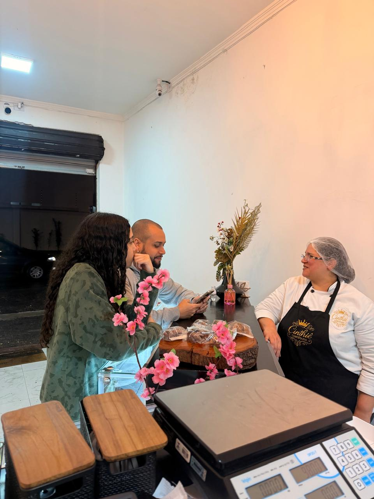
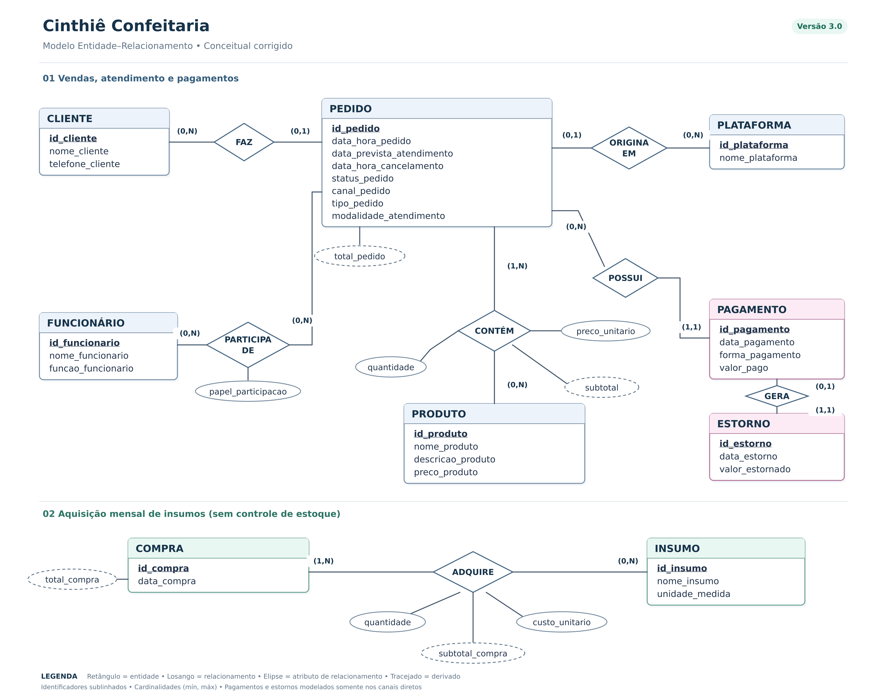

# Cinthiê Confeitaria — Modelagem de Banco de Dados
### Revisão conceitual e conversão inicial para o modelo lógico (Entrega 2)
## Sistema de gestão de informações da Cinthiê Confeitaria

## Metadados

- **Integrantes e RGM:**
  - Douglas Lourenço de Lima — RGM: 47892919
  - Erick Costa Liberato — RGM: 48201693
  - João Lucas Moreira dos Reis — RGM: 48162086
  - Nicolas Nogueira Borges — RGM: 48329266
- **Disciplina:** Modelagem de Banco de Dados
- **Organização analisada:** Cinthiê Confeitaria
- **Versão do documento:** 3.0 — revisão do DER e conversão lógica (05/11/2026)

---

## 1. Caracterização da Organização

### Nome e natureza da organização

A organização analisada é a **Cinthiê Confeitaria**, empresa do ramo alimentício que fabrica e comercializa produtos de confeitaria no próprio estabelecimento.

### Contexto e porte

Segundo a entrevista realizada com a responsável pelo estabelecimento, a confeitaria possui três funcionários. As atividades são distribuídas da seguinte forma:

- uma funcionária exerce as funções de **gerente e confeiteira**;
- um funcionário exerce as funções de **ajudante de cozinha e responsável pelo atendimento no balcão**;
- um funcionário exerce a função de **motoboy/entregador**.

A confeitaria atende clientes **no próprio salão, com mesas para consumo no local**, além de realizar vendas no **balcão**, receber **encomendas pelo WhatsApp** e receber **pedidos de entrega no mesmo dia pelos aplicativos iFood e Keeta**. WhatsApp e balcão são canais diretos; iFood e Keeta são plataformas de venda. **Os aplicativos não são utilizados para encomendas agendadas.**

Há **produtos prontos para venda no balcão e consumo nas mesas**, além de encomendas contratadas pelo WhatsApp e pedidos de entrega no dia pelos aplicativos. A produção relatada inclui atividades aos **domingos e às quartas-feiras**, sem pressupor que toda a produção se limite a esses dias. A **compra de insumos é realizada uma vez por mês**. O modelo registra compras mensais e itens adquiridos, mas não implementa controle de estoque de ingredientes ou produtos prontos; essa é uma delimitação do sistema proposto, e não a afirmação de inexistência de mercadorias disponíveis no estabelecimento.

### Problemas e necessidades identificados

Atualmente, as informações da organização estão distribuídas entre WhatsApp, planilhas do Microsoft Excel e plataformas de venda. Parte do controle administrativo é realizada ao final do expediente, o que torna a organização e a consolidação das informações mais demoradas.

O sistema proposto busca centralizar os dados de clientes, pedidos, produtos, pagamentos diretos, eventuais estornos, plataformas, funcionários, insumos e compras, reduzindo o tempo gasto na consolidação de informações.

### Justificativa da escolha

A Cinthiê Confeitaria foi escolhida por ser uma organização real de pequeno porte e por permitir ao grupo a realização de pesquisa de campo. O estabelecimento possui uma rotina que envolve atendimento ao cliente, recebimento de pedidos por diferentes canais, fabricação sob demanda, pagamentos, entregas e controle administrativo, o que possibilita identificar entidades, atributos e relacionamentos relevantes para a elaboração de um modelo conceitual de dados.

Além disso, a utilização de WhatsApp, planilhas e plataformas de venda demonstra a existência de diferentes fontes de informação que podem ser organizadas de forma centralizada por meio de um banco de dados.

### Evidências da organização

Como evidências da pesquisa de campo, foram realizadas fotografias do estabelecimento e uma gravação de áudio da entrevista com a responsável pela confeitaria. Esses materiais foram utilizados para apoiar o levantamento das informações, respeitando a autorização e a privacidade das pessoas envolvidas.



**Endereço do estabelecimento:** R. Césario Galero, 262, Tatuapé — São Paulo — SP, CEP 03071-000.

**Contato comercial:** não informado; incluir apenas após confirmação com a responsável.

**Fonte primária:** entrevista presencial e registros fotográficos descritos pelo grupo. Os pontos ainda não confirmados estão explicitamente sinalizados abaixo.

---

## 2. Processos de Negócio

Os processos a seguir combinam **rotinas relatadas no levantamento** com **etapas que precisam ser confirmadas na entrevista complementar**. O fluxo descreve operações reais ou relevantes à caracterização da confeitaria; sua inclusão nesta seção **não significa** que todas serão implementadas no banco de dados desta Entrega 1.

### 2.1 Atendimento e identificação de clientes

- **Entrada:** solicitação presencial, mensagem de WhatsApp ou pedido recebido pela plataforma.
- **Atividades:** entender a solicitação; identificar o cliente quando necessário e quando os dados estiverem disponíveis; esclarecer produto, quantidade e condições do atendimento.
- **Saída:** informações que permitem registrar o pedido. No balcão, pode haver pedido sem cliente cadastrado, como admite a cardinalidade do DER.

### 2.2 Recebimento de pedidos multicanal e consumo no local

- **Entrada:** compra para consumo no local, solicitação no balcão, encomenda pelo WhatsApp ou pedido de entrega no dia via iFood ou Keeta.
- **Atividades:** identificar a origem; diferenciar venda presencial, encomenda e pedido imediato do aplicativo; se for plataforma, registrar qual delas; selecionar produtos; informar quantidades e preços praticados; registrar o status inicial.
- **Limite do DER:** a distinção entre balcão e consumo nas mesas é operacional; o modelo atual não possui atributo específico para número de mesa ou atendimento no salão.
- **Saída:** pedido registrado e associado a pelo menos um produto.

### 2.3 Cardápio e preços

- **Entrada:** catálogo de produtos e preços definidos pela confeitaria.
- **Atividades propostas para o sistema:** cadastrar e consultar produtos e seus preços atuais; ao vender, preservar o preço unitário praticado no vínculo entre produto e pedido.
- **Saída:** pedido com valores históricos coerentes, mesmo se o preço cadastrado do produto mudar.
- **A confirmar:** quem altera o cardápio, com qual frequência e se os preços diferem entre canais.

### 2.4 Encomendas pelo WhatsApp e agendamento

- **Entrada:** solicitação de encomenda pelo WhatsApp; os aplicativos não recebem encomendas agendadas.
- **Atividades:** confirmar itens e quantidades; negociar a data e a modalidade de recebimento; verificar disponibilidade de produção; informar o valor total e as condições de pagamento. **As encomendas feitas pelo WhatsApp exigem pagamento antecipado**, conforme informação complementar da responsável.
- **Saída:** encomenda aceita e acompanhada pelo pedido.
- **Confirmado:** pagamento antecipado nas encomendas por WhatsApp; cancelamentos de encomendas pelo WhatsApp, inclusive com menos de sete dias de antecedência da entrega, não geram multa nem retenção, com **devolução integral (100%) do valor pago**.
- **A confirmar:** a antecedência mínima para **fazer** a encomenda e os procedimentos operacionais de estorno. O prazo de sete dias não altera o percentual devolvido. O DER revisado registra a data prevista de atendimento, mas o prazo de sete dias não altera a regra de reembolso integral.

### 2.5 Produção sob demanda

- **Entrada:** pedidos e encomendas aceitos.
- **Atividades:** planejar o preparo em função da demanda, produzir os itens e atualizar o andamento do pedido. O levantamento relata produção aos domingos e quartas-feiras.
- **Saída:** pedido preparado para entrega ou retirada.
- **Limite de escopo:** não há módulo de estoque ou ficha técnica de ingredientes na modelagem atual.

### 2.6 Entrega dos pedidos no dia e de encomendas

- **Entrada:** pedido pronto para envio.
- **Atividades:** organizar o encaminhamento e a participação do funcionário que executa a entrega; acompanhar o estado do pedido.
- **Saída:** pedido entregue e concluído.
- **A confirmar:** área atendida, cálculo de taxa, registro de endereço, comprovante e tratamento de entregas intermediadas por plataformas. O DER não possui entidade ENTREGA.

### 2.7 Retirada no balcão e consumo no estabelecimento

- **Entrada:** produto selecionado para consumo no local ou pedido pronto para retirada.
- **Atividades:** disponibilizar o produto, atender clientes nas mesas quando aplicável, conferir dados do pedido quando necessários e concluir o atendimento.
- **Saída:** pedido retirado e situação atualizada.
- **A confirmar:** procedimento utilizado para comunicar que a encomenda está pronta.

### 2.8 Pagamento dos pedidos diretos

- **Canais:** WhatsApp e balcão, com dinheiro, Pix ou cartão (incluindo maquininha).
- **Regra confirmada:** não há taxa ou multa de cancelamento para pagamentos nos canais diretos. Maquininha é meio de processamento de cartão, não um aplicativo de venda.
- **Encomendas por WhatsApp:** exigem pagamento antecipado; em caso de cancelamento, a devolução é integral (100% do valor pago), inclusive com menos de sete dias de antecedência.
- **Modelagem:** PEDIDO pode possuir zero ou vários PAGAMENTOS (ex.: recebimentos em etapas, se ocorrerem); um PAGAMENTO pertence a um único PEDIDO. ESTORNO representa uma devolução vinculada a um PAGAMENTO direto, quando realizada; no máximo um estorno por pagamento nesta versão.
- **Limite:** não se presume parcelamento/sinal e saldo como prática confirmada; a cardinalidade permite expansão futura, sem obrigar seu uso.

### 2.9 Pedidos de aplicativo e repasses

- iFood e Keeta recebem pedidos para entrega no mesmo dia, sem encomendas agendadas.
- O PEDIDO registra o canal e qual PLATAFORMA o originou; **o pagamento, eventual cancelamento, estorno e possíveis taxas são processados pelo próprio aplicativo**, conforme suas políticas.
- O sistema da confeitaria **não cria PAGAMENTO nem ESTORNO internos para esses pedidos de aplicativo**. A conferência de repasses é descrita como processo administrativo, ainda sem entidade REPASSE.

### 2.10 Cancelamento e reembolso por canal

- **WhatsApp, balcão e pagamentos na maquininha:** não existe taxa ou multa de cancelamento cobrada pela confeitaria.
- **Encomendas por WhatsApp:** quando há cancelamento de encomenda já paga, devolve-se **100% do valor pago**, independentemente de faltarem mais ou menos de sete dias para a data prevista.
- **Balcão:** o cancelamento não possui taxa; se ainda não houve recebimento, não há estorno a registrar. Quando um valor tiver sido recebido e devolvido, é possível registrar ESTORNO com o valor efetivamente devolvido. A forma concreta de devolução no balcão deve ser validada na entrevista.
- **iFood e Keeta:** pagamento, cancelamento e eventual devolução são tratados exclusivamente no aplicativo, sem lançamento de estorno interno pela confeitaria.
- **Dados:** PEDIDO guarda status e data/hora de cancelamento; o histórico financeiro direto é mantido em PAGAMENTO e ESTORNO. Não há atributo `taxa_cancelamento` pois a taxa direta é zero e as taxas dos apps são externas.

### 2.11 Compra de ingredientes e relacionamento com fornecedores

- **Entrada:** necessidade de ingredientes e embalagens para atender à produção.
- **Atividades:** aquisição de insumos **uma vez por mês**, para atender à produção de encomendas e de produtos comercializados no balcão. As etapas específicas de seleção de fornecedores, recebimento e conferência de validades ainda precisam ser confirmadas.
- **Saída:** insumos disponíveis para a produção.
- **Confirmado:** periodicidade mensal das compras e existência de produtos para venda no balcão. **A confirmar:** nomes dos fornecedores, responsáveis pelas compras, armazenamento e controle de validade. **INSUMO e COMPRA estão no DER revisado; FORNECEDOR e ESTOQUE permanecem fora do escopo**, embora seu processo operacional esteja documentado.

**Modelagem confirmada como proposta:** COMPRA contém uma data e um ou mais INSUMOS adquiridos, com quantidade e custo unitário. O cadastro descreve compras, não consumo, saldo de estoque nem controle de validade. O valor total da compra é derivado da soma dos subtotais.

### 2.12 Controle administrativo e caixa

- **Entrada:** pedidos, pagamentos e dados de vendas por canais e plataformas.
- **Atividades:** conferir os registros, consultar vendas por período e consolidar informações; atualmente, parte desse trabalho utiliza Excel e acontece ao final do expediente.
- **Saída:** visão administrativa das operações e dos valores recebidos ou a receber.
- **A confirmar:** abertura/fechamento de caixa, conciliação, despesas e periodicidade dos relatórios.

### 2.13 Fluxo geral dos dados

```mermaid
flowchart TD
    A[Solicitação de compra] --> B{Canal e modalidade}
    B -->|Salão ou balcão| C[Venda de produto disponível]
    B -->|WhatsApp: encomenda| D[Definir produtos e data de entrega]
    B -->|iFood ou Keeta| E[Pedido para entrega no mesmo dia]
    D --> F[Receber pagamento antecipado]
    F --> G{Cancelamento solicitado?}
    G -->|Sim, inclusive a menos de 7 dias| H[Devolução integral (100%), sem multa]
    G -->|Não| I[Produzir encomenda]
    C --> J[Concluir atendimento presencial]
    E --> K[Preparar e encaminhar entrega no dia]
    I --> L[Entregar ou disponibilizar retirada]
    H --> M[Atualizar status e controle financeiro]
    J --> M
    K --> M
    L --> M
```

> **Observação:** o fluxo resume as regras operacionais relatadas. A ausência de cobrança de cancelamento nos canais diretos e os detalhes do atendimento nas mesas ainda exigem confirmação para implementação.

---

## 3. Requisitos Funcionais

| Código | Requisito funcional |
|---|---|
| RF01 | O sistema deve permitir cadastrar clientes. |
| RF02 | O sistema deve permitir consultar clientes cadastrados. |
| RF03 | O sistema deve permitir registrar pedidos. |
| RF04 | O sistema deve permitir consultar pedidos registrados. |
| RF05 | O sistema deve permitir cadastrar produtos. |
| RF06 | O sistema deve permitir consultar produtos cadastrados. |
| RF07 | O sistema deve permitir associar um ou mais produtos a cada pedido, registrando a quantidade solicitada. |
| RF08 | O sistema deve permitir registrar e consultar o status do pedido. |
| RF09 | O sistema deve permitir registrar pagamentos relacionados aos pedidos. |
| RF10 | O sistema deve permitir registrar a forma de pagamento dos pedidos realizados pelo WhatsApp ou balcão: dinheiro, cartão ou Pix. |
| RF11 | O sistema deve permitir registrar pagamentos de pedidos realizados por plataforma sem exigir a forma de pagamento utilizada pelo cliente. |
| RF12 | O sistema deve permitir identificar o canal de origem de cada pedido: WhatsApp, balcão ou plataforma. |
| RF13 | O sistema deve permitir vincular pedidos realizados por plataforma ao iFood ou à Keeta. |
| RF14 | O sistema deve permitir consultar informações de vendas por período, produto, canal e plataforma. |
| RF15 | O sistema deve permitir cadastrar funcionários. |
| RF16 | O sistema deve permitir consultar funcionários cadastrados e suas funções. |
| RF17 | O sistema deve permitir associar ao pedido os funcionários que participaram do atendimento, produção ou entrega, quando essa informação for registrada. |
| RF18 | O sistema deve registrar a data prevista de atendimento de encomendas e o momento de cancelamento, quando aplicável. |
| RF19 | O sistema deve registrar pagamentos diretos vinculados aos pedidos por WhatsApp ou balcão, sem taxa de cancelamento. |
| RF20 | O sistema deve permitir registrar estornos de pagamentos diretos, vinculados aos pagamentos originais e aos valores efetivamente devolvidos. |
| RF21 | O sistema deve impedir lançamentos internos de PAGAMENTO e ESTORNO para pedidos processados integralmente por iFood ou Keeta. |
| RF22 | O sistema deve permitir cadastrar INSUMO com nome e unidade de medida. |
| RF23 | O sistema deve permitir registrar COMPRA com data e insumos adquiridos, quantidades e custos unitários. |
| RF24 | O sistema deve permitir apurar subtotais e totais derivados de PEDIDO e COMPRA a partir das relações correspondentes. |


---

## 4. Regras de Negócio — revisão da Entrega 2

As regras abaixo consolidam o levantamento anterior com as informações recentes do grupo. Os códigos originais são mantidos sempre que possível, e a revisão é datada para rastreabilidade.

| Código | Regra atualizada |
|---|---|
| RN01 | Todo PEDIDO possui canal de origem: WhatsApp, balcão ou plataforma. |
| RN02 | WhatsApp e balcão são canais diretos; não pertencem à entidade PLATAFORMA. |
| RN03 | As plataformas atualmente utilizadas são iFood e Keeta (informação da operação, não limite permanente). |
| RN04 | PEDIDO de plataforma identifica uma PLATAFORMA; PEDIDO direto não possui plataforma vinculada. |
| RN05 | Cada PEDIDO deve conter pelo menos um PRODUTO. |
| RN06 | A relação CONTÉM registra `quantidade` e `preco_unitario` praticado, preservando o preço histórico. |
| RN07 | O `total_pedido` é derivado da soma de `quantidade × preco_unitario`. |
| RN08 | O PEDIDO mantém `status_pedido`; se cancelado, pode registrar `data_hora_cancelamento`. |
| RN09 | PEDIDO direto pode possuir zero ou vários PAGAMENTOS; cada PAGAMENTO corresponde a um único PEDIDO direto. A confirmação de encomenda por WhatsApp requer pagamento antecipado. |
| RN10 | Nos pagamentos diretos, registrar forma de pagamento como dinheiro, Pix ou cartão (inclusive maquininha). **Não existe taxa de cancelamento** nesses canais. |
| RN11 | Em iFood/Keeta, pagamento, cancelamento e eventual estorno permanecem na própria plataforma. Não registrar transações PAGAMENTO ou ESTORNO internas para esses pedidos. |
| RN12 | O sistema registra COMPRA e INSUMO da aquisição mensal, mas não calcula saldo de estoque nem consumo de ingredientes. |
| RN13 | Foi relatada produção aos domingos e quartas-feiras, sem presumir exclusividade desses dias. |
| RN14 | Há três funcionários na operação observada; isso não impõe limite de cadastro no banco. |
| RN15 | FUNCIONÁRIO e PEDIDO possuem relacionamento N:N, com `papel_participacao`. |
| RN16 | Repasses dos aplicativos são conferidos administrativamente; não há módulo próprio de REPASSE. |
| RN17 | Encomenda via WhatsApp possui data prevista de entrega ou retirada. |
| RN18 | Não foi definida antecedência mínima obrigatória para contratar encomenda; o prazo de sete dias **não gera multa de cancelamento**. |
| RN19 | Encomenda WhatsApp tem pagamento antecipado. |
| RN20 | No cancelamento de encomenda via WhatsApp paga, o cliente recebe **100% do valor pago**, inclusive com menos de sete dias de antecedência. |
| RN21 | O pagamento direto já recebido pode gerar ESTORNO; o valor devolvido é registrado e relacionado ao pagamento original. |
| RN22 | Dados pessoais requerem acesso controlado e proteção conforme LGPD. |
| RN23 | Compras e manipulação de alimentos seguem regras sanitárias aplicáveis, cuja execução local deve ser confirmada. |
| RN24 | Obrigações fiscais e comprovantes da operação dependem do enquadramento a confirmar na organização. |
| RN25 | Cada COMPRA possui um ou mais INSUMOS, registrando `quantidade` e `custo_unitario` no relacionamento ADQUIRE. |
| RN26 | `subtotal_compra` e `total_compra` são derivados dos custos de compra; não são dados de estoque. |
| RN27 | Para um mesmo PAGAMENTO direto, esta versão admite no máximo um ESTORNO; devoluções parceladas exigiriam ampliação posterior. |
| RN28 | O modelo não armazena taxas de cancelamento de aplicativos como se fossem cobradas pela confeitaria. |

**Pendências de validação com a responsável:** volume mensal de compras e pedidos, identificação de fornecedores, quem realiza compras, eventual devolução de compras no balcão, e procedimentos/timing de estornos em Pix, dinheiro e cartão. Não foram inventadas taxas, fornecedores nem quantidades.

---

## 5. Modelagem Conceitual Revisada

### Entidades e justificativas

| Entidade | Informação representada |
|---|---|
| CLIENTE | Identificação e contato quando disponíveis. |
| FUNCIONÁRIO | Equipe de atendimento, produção ou entrega. |
| PRODUTO | Catálogo de produtos comercializados. |
| PEDIDO | Origem, tipo, modalidade, datas e situação da venda/encomenda. |
| PLATAFORMA | Identifica iFood ou Keeta, quando pedido é originado por aplicativo. |
| PAGAMENTO | Recebimentos de pedidos **diretos**, vinculados ao pedido. |
| ESTORNO | Devolução de valores recebidos em pagamento **direto**. |
| COMPRA | Aquisição de insumos registrada por data. |
| INSUMO | Item comprado para produção, sem monitoramento de estoque. |

### Relacionamentos e cardinalidades

| Relação | Cardinalidades (máximo de ocorrências do outro lado) | Observação |
|---|---|---|
| CLIENTE **FAZ** PEDIDO | CLIENTE (0,N) — PEDIDO (0,1) | Pedido pode não ter cliente cadastrado. |
| FUNCIONÁRIO **PARTICIPA DE** PEDIDO | FUNCIONÁRIO (0,N) — PEDIDO (0,N) | Atributo `papel_participacao`. |
| PEDIDO **ORIGINA EM** PLATAFORMA | PEDIDO (0,1) — PLATAFORMA (0,N) | Obrigatório somente para canal plataforma. |
| PEDIDO **POSSUI** PAGAMENTO | PEDIDO (0,N) — PAGAMENTO (1,1) | Pagamentos internos somente para canais diretos. |
| PAGAMENTO **GERA** ESTORNO | PAGAMENTO (0,1) — ESTORNO (1,1) | Um estorno, no máximo, por recebimento nesta versão. |
| PEDIDO **CONTÉM** PRODUTO | PEDIDO (1,N) — PRODUTO (0,N) | `quantidade`, `preco_unitario` e subtotal derivado. |
| COMPRA **ADQUIRE** INSUMO | COMPRA (1,N) — INSUMO (0,N) | `quantidade`, `custo_unitario` e subtotal derivado. |

**Convenções:** entidades em retângulos, relacionamentos em losangos e cardinalidades (mínimo, máximo). Os identificadores estão sublinhados. Os atributos próprios dos relacionamentos aparecem em elipses. `total_pedido` e `total_compra` estão fora dos retângulos e representados por elipses tracejadas, assim como os subtotais derivados. Não há chaves estrangeiras no DER conceitual.

### Limites assumidos

- Sem saldo de estoque, ficha técnica de receitas, fornecedor ou controle de entrada e saída de ingrediente.
- A entidade COMPRA registra a **aquisição**, não o consumo nem a quantidade disponível de INSUMO.
- Pagamentos e estornos de aplicativo continuam na plataforma; apenas o PEDIDO e sua origem são registrados internamente.
- O estorno de pagamento direto é operação distinta do cancelamento do PEDIDO; cancelar antes de pagar não gera estorno.

---

## 6. DER Conceitual — Diagrama Atualizado



[**Versão SVG editável do DER**](assets/der_conceitual_corrigido.svg)

**Revisões incorporadas:** compras e insumos; totais derivados ligados externamente; cancelamento direto sem taxa; ESTORNO para recebimentos diretos; vínculo PEDIDO–PAGAMENTO ajustado de (0,1) para (0,N); aplicativos mantidos como plataformas externas.

---

## 7. Conversão para o Modelo Lógico

A notação relacional exige tabelas associativas para cada N:N. Assim, a decisão de **não criar ITEM_PEDIDO como entidade conceitual** é preservada, enquanto `ITEM_PEDIDO` aparece necessariamente no **modelo lógico**. O mesmo acontece com `PEDIDO_FUNCIONARIO` e `COMPRA_INSUMO`.


[**Modelo lógico SVG editável**](assets/modelo_logico_corrigido.svg) · [**Descrição completa das tabelas e chaves**](docs/modelo_logico.md)

### Principais regras de conversão

- Relacionamentos N:N → tabelas próprias com PK composta e FKs: `ITEM_PEDIDO`, `PEDIDO_FUNCIONARIO`, `COMPRA_INSUMO`.
- Relacionamentos 1:N → chave estrangeira no lado N (`PEDIDO.id_cliente`, `PAGAMENTO.id_pedido`, por exemplo).
- Relacionamento 1:1 opcional `PAGAMENTO`–`ESTORNO` → FK `ESTORNO.id_pagamento` com restrição `UNIQUE`.
- `total_pedido`, `subtotal`, `total_compra` e `subtotal_compra` são derivados, calculados por consultas (não armazenados como dados redundantes).
- Para PEDIDO de PLATAFORMA, `id_plataforma` é informado; não se gera PAGAMENTO interno.

### Estado da Entrega 2

Esta revisão cobre **DER, dicionário de dados, conversão inicial e modelo lógico**. Ainda são tarefas distintas a serem concluídas e validadas para a entrega integral: implementação SQL testada, massa de dados fictícios, consultas gerenciais/auditoria, normalização documentada e pitch. Não apresentar esta revisão isolada como a Entrega 2 completa.

---

## 8. Uso de Inteligência Artificial

| Item | Registro |
|---|---|
| Ferramenta e etapa | ChatGPT/Codex foi utilizado para organizar informações da entrevista, revisar requisitos, discutir regras de negócio, identificar inconsistências e apoiar a elaboração do DER e deste README. |
| Motivação | Estruturar o trabalho conforme as orientações da disciplina, melhorar a coerência entre as seções e revisar a modelagem conceitual. |
| Prompt(s) utilizados | O texto exato dos prompts da fase inicial não foi preservado neste repositório; não é adequado reconstruí-los como se fossem transcrições. Registrar abaixo prompts documentados a partir desta revisão, com data e finalidade. |
| Sugestões recebidas | Foram sugeridas revisões de entidades, relacionamentos, cardinalidades, requisitos, regras de negócio e redação. |
| Trechos rejeitados ou corrigidos | Foram corrigidas sugestões anteriores que tratavam o motoboy como terceirizado, que incluíam controle de estoque e que criavam ITEM_PEDIDO diretamente no DER conceitual. No modelo lógico, a tabela associativa é necessária. Também foram revistas informações sobre canais de pedido e formas de pagamento. |
| Justificativa da escolha final | O grupo manteve as decisões compatíveis com a entrevista, com as informações posteriormente confirmadas sobre o funcionamento da confeitaria e com a orientação do professor para a modelagem conceitual. |
| Reflexão crítica | A IA foi utilizada como ferramenta de apoio à organização e revisão do trabalho. As informações sobre a organização foram obtidas na pesquisa de campo, e o grupo permaneceu responsável por verificar as sugestões e decidir quais alterações eram compatíveis com a realidade observada. |

### 8.1 Registro verificável da revisão assistida por IA

- **Data:** 30/10/2026.
- **Ferramenta:** ChatGPT.
- **Prompt do usuário (resumo fiel do pedido recebido nesta revisão, não transcrição da primeira fase):** "Corrija o README e remova uma integrante da lista de participantes", acompanhado da avaliação detalhada do professor e dos critérios de desconto.
- **Material de entrada:** `README.md` do projeto e parecer com critérios 1 a 12, lacunas de processos, regras de negócio, dicionário e uso de IA.
- **Saída adotada:** retirada de uma integrante da lista; ampliação de processos e fluxos; separação entre regras operacionais, fatos organizacionais e políticas a validar; explicitação das limitações do DER e do escopo.
- **Conferência humana necessária:** validar os detalhes ainda desconhecidos de agendamento, fornecedores, cancelamentos e reembolsos, entrega, impostos e uso de dados pessoais com a responsável e o professor; revisar esta versão antes da entrega.
- **Propostas não adotadas automaticamente:** inventar porcentagem de sinal ou novas condições de devolução, prazo fixo de encomenda, tarifas de entrega ou fornecedores inexistentes no levantamento.

### 8.2 Complemento do levantamento durante a revisão

- **Informações fornecidas pelo grupo:** a confeitaria dispõe de mesas para consumo; os aplicativos recebem apenas pedidos para entrega no dia; as encomendas são feitas pelo WhatsApp, com pagamento antecipado; cancelamentos das encomendas via WhatsApp, inclusive quando solicitados com menos de sete dias de antecedência da entrega, têm devolução integral (100%) do valor antecipadamente pago, sem ônus para cliente e estabelecimento.
- **Interpretação documental:** a regra foi atualizada para explicitar que o prazo de sete dias **não impõe retenção ou multa**; tanto antes quanto dentro dos sete dias prévios à entrega, o reembolso informado é de 100% do pagamento antecipado. A forma e o prazo operacional do estorno ainda precisam ser definidos.
- **Alteração aplicada:** atualização da caracterização, dos processos, do fluxo e das regras; posterior revisão do DER em 05/11/2026, em conjunto com o dicionário e o modelo lógico.

> **Transparência:** os prompts originais anteriores à revisão não constam dos arquivos fornecidos. Para documentar o histórico completo, anexar suas transcrições originais quando disponíveis; não substituir por exemplos fictícios.

---

## 9. Dicionário de Dados e Arquivos

- [Dicionário de dados atualizado em HTML](dicionario-dados.html).
- [DER conceitual corrigido em PNG](assets/der_conceitual_corrigido.png) e [SVG](assets/der_conceitual_corrigido.svg).
- [Modelo lógico relacional em PNG](assets/modelo_logico_corrigido.png) e [SVG](assets/modelo_logico_corrigido.svg).
- [Relação de tabelas, PKs, FKs e domínios](docs/modelo_logico.md).

### 9.1 Registro da revisão de 05/11/2026 com apoio de IA

- **Solicitação do grupo:** corrigir modelagem de compras e insumos, representar `total_pedido` como atributo derivado externo, registrar estornos e atualizar a conversão N:N para o modelo lógico.
- **Correção adicional fornecida pelo grupo:** cancelamentos em WhatsApp, balcão e pagamentos via maquininha não têm cobrança de taxa; pagamentos, cancelamentos e estornos por aplicativos continuam nos próprios apps.
- **Solução adotada:** inclusão de COMPRA, INSUMO e ESTORNO; cardinalidades financeiras revisadas; totais calculados; modelo lógico com tabelas associativas; documentos compatibilizados.
- **Limites preservados:** não se presumem taxa de aplicativo, forma de reembolso do balcão, fornecedor, saldo de estoque nem volume mensal de compras; essas informações precisam de confirmação com a organização.
- **Ferramenta:** ChatGPT, em 05/11/2026, como assistência para a modelagem e revisão documental. Todo material deve ser validado pelo grupo antes da entrega.
